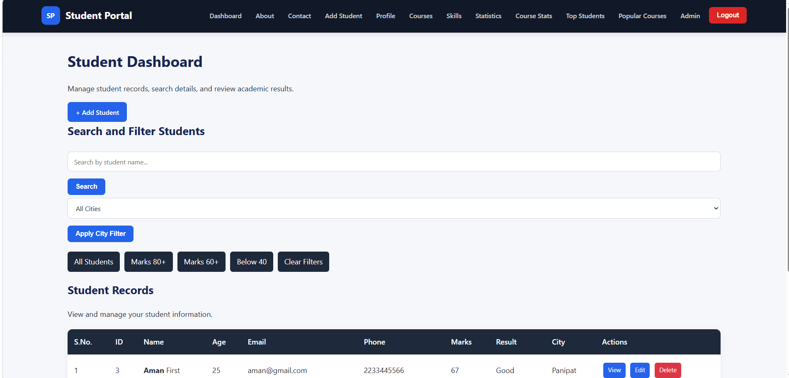
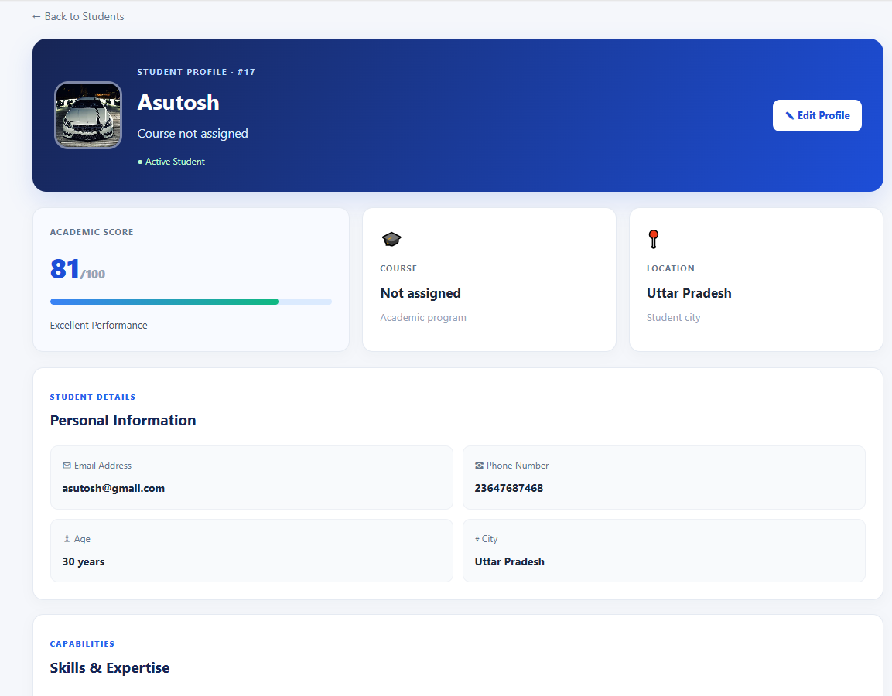
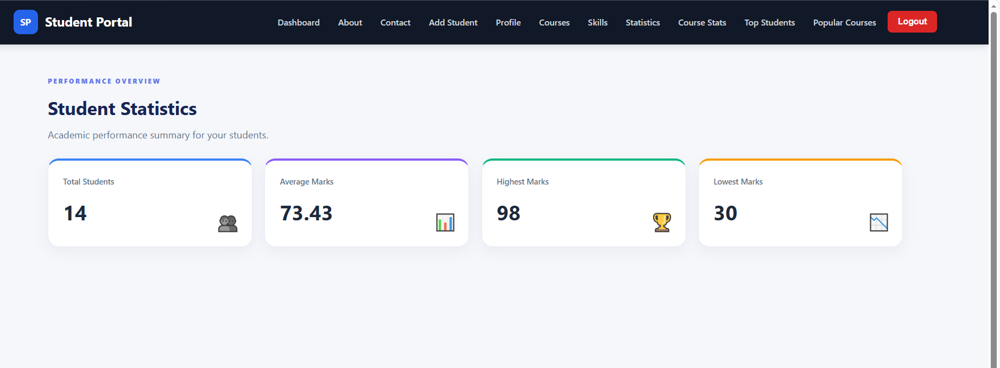
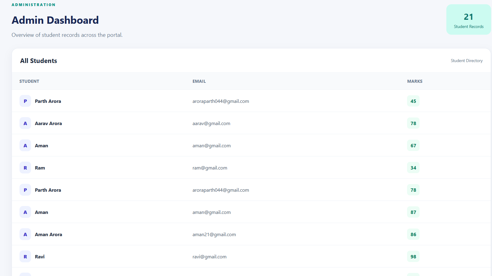

# Student Management Portal

A Django-based Student Management Portal for managing student records, courses, skills, and academic performance through a responsive web interface.

**Tech stack:** Python · Django · Django REST Framework · HTML · CSS · SQLite

## Features

- Add, view, update, and delete student records
- Search students by name or city
- Filter students by city and marks
- Paginated student directory
- Student detail pages with profile images, documents, and skills
- Course and skill detail pages
- Student statistics: total, average, highest, and lowest marks
- Top students and popular courses
- User registration, login, logout, and profile pages
- User-scoped student records
- Admin-only dashboard
- Authenticated Django REST Framework API

## Screenshots

Create a `screenshots/` folder and add your own screenshots using these filenames:

| Dashboard | Student Details |
|---|---|
|  |  |

| Statistics | Admin Dashboard |
|---|---|
|  |  |

Use demo data in screenshots. Do not publish real student personal information.

## Tech Stack

- **Backend:** Python, Django
- **API:** Django REST Framework
- **Frontend:** Django Templates, HTML, CSS
- **Database:** SQLite for local development
- **Authentication:** Django authentication system

## Project Structure

Update folder names below if your actual project uses different names.

```text
student-management-portal/
├── manage.py
├── requirements.txt
├── config/                 # Django project settings and root URLs
├── students/               # Models, views, URLs, forms, API, signals
├── templates/              # Django templates
├── static/
│   └── css/
│       └── style.css
└── screenshots/            # Project screenshots
```

## Getting Started

### Requirements

- Python 3.10 or newer (use a version supported by your dependencies)
- Git

### 1. Clone the repository

```bash
git clone https://github.com/Parth1324355675/Student-management_System_Django
cd StudentPortal
```

Replace the placeholders with your GitHub repository URL and local folder name.

### 2. Create a virtual environment

**Windows PowerShell:**

```powershell
python -m venv venv
.\venv\Scripts\Activate.ps1
```

**Windows Command Prompt:**

```bat
python -m venv venv
venv\Scripts\activate
```

**macOS / Linux:**

```bash
python3 -m venv venv
source venv/bin/activate
```

### 3. Install dependencies

```bash
python -m pip install --upgrade pip
pip install -r requirements.txt
```

If you do not have a `requirements.txt` yet, create it from your active environment:

```bash
pip freeze > requirements.txt
```

### 4. Apply migrations

```bash
python manage.py migrate
```

### 5. Create an administrator account

```bash
python manage.py createsuperuser
```

Follow the prompts to create the account.

### 6. Start the development server

```bash
python manage.py runserver
```

Open these addresses in your browser:

- Application: http://127.0.0.1:8000/
- Django Admin: http://127.0.0.1:8000/admin/

Register a normal user through the application to test user-level features. Use an authorized admin account for admin-only functionality.

## API

The project includes a Django REST Framework student API. If your root URL configuration mounts the API at `/api/`, the router endpoints are typically:

| Method | Endpoint | Purpose |
|---|---|---|
| GET | `/api/students/` | List the authenticated user's students |
| POST | `/api/students/` | Create a student |
| GET | `/api/students/<id>/` | Retrieve a student |
| PUT | `/api/students/<id>/` | Update a student |
| PATCH | `/api/students/<id>/` | Partially update a student |
| DELETE | `/api/students/<id>/` | Delete a student |

API access requires authentication according to your Django REST Framework settings. Confirm the `/api/` prefix in your project's root `urls.py`.

## Useful Commands

```bash
# Check the Django project for configuration issues
python manage.py check

# Apply database migrations
python manage.py migrate

# Create an admin account
python manage.py createsuperuser

# Run automated tests
python manage.py test

# Start the local server
python manage.py runserver
```

## Before Deployment

Before making the project public:

- Set `DEBUG=False`.
- Set a strong, private `DJANGO_SECRET_KEY` using your hosting provider's environment variables.
- Configure `DJANGO_ALLOWED_HOSTS` for your deployed domain.
- Do not commit `.env`, database files, uploaded private media, passwords, or secret keys.
- Configure a production database and static-file serving.
- Use HTTPS and secure cookie settings.

The development fallback secret key must never be used in production.

## Future Improvements

- Add automated tests for views, permissions, and API endpoints
- Add CSV or Excel export
- Add charts and downloadable academic reports
- Add deployment configuration and production database support

## Contributing

1. Fork the repository.
2. Create a feature branch: `git checkout -b feature/your-feature`
3. Commit your changes.
4. Push your branch and open a pull request.

## License

Add a `LICENSE` file if you want to grant specific reuse and distribution permissions.

## Author

**Parth Arora**  
Student Management Portal · Django Project
